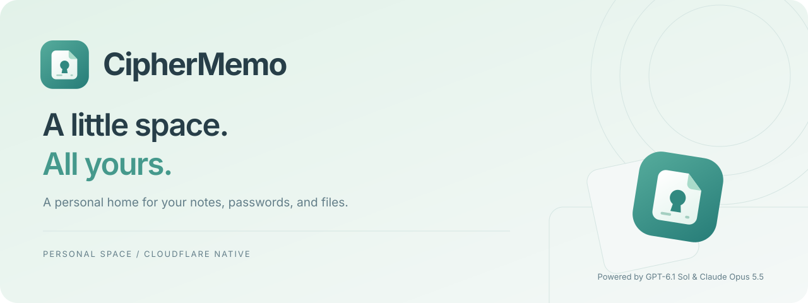
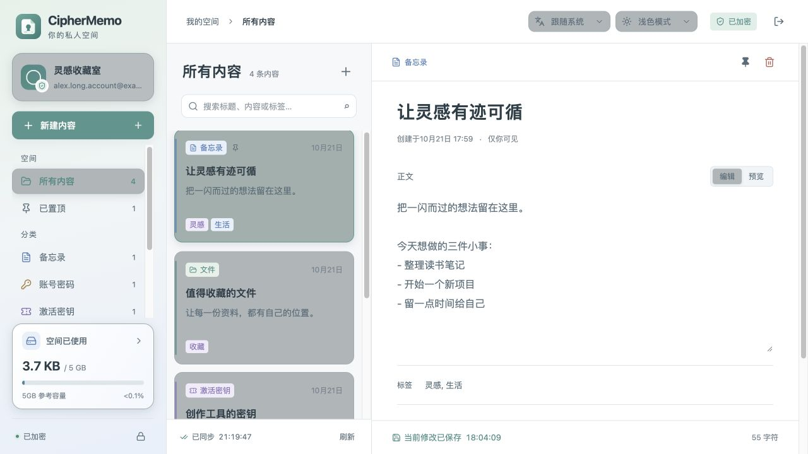
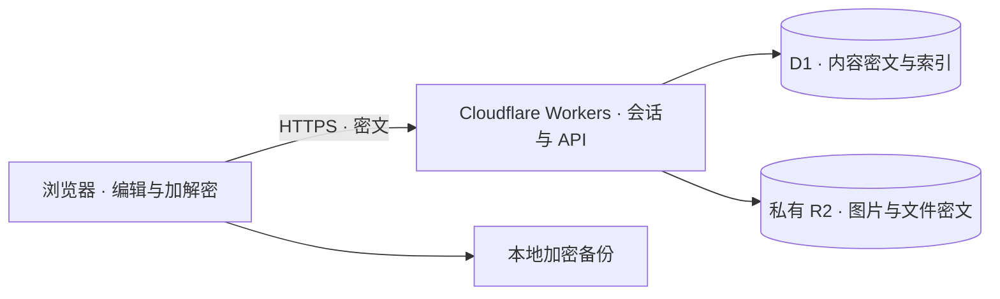

<div align="center">
  <picture>
    <source media="(prefers-color-scheme: dark)" srcset="public/brand/readme-hero-dark.svg">
    
  </picture>

  <p><strong>给重要的内容，一个安心的归处。</strong></p>
  <p>笔记、账号密码、软件密钥与文件，放进部署在自己 Cloudflare 上的私人空间。</p>

  <p>
    <a href="https://github.com/wangmancang520/ciphermemo/actions/workflows/ci.yml"></a>
    <a href="package.json"></a>
    <a href="docs/DEVELOPMENT.md"></a>
    <a href="docs/ARCHITECTURE.md"></a>
  </p>

  <p>
    <a href="#快速部署">快速部署</a> ·
    <a href="#界面预览">界面预览</a> ·
    <a href="#功能概览">功能概览</a> ·
    <a href="docs/DEPLOYMENT.md">部署文档</a> ·
    <a href="docs/SECURITY.md">安全设计</a> ·
    <a href="CONTRIBUTING.md">参与贡献</a>
  </p>

  <p><strong>Powered by GPT-6.1 Sol</strong> · 本项目由 AI 生成并协助开发。</p>
</div>

---

## 为什么是 CipherMemo

CipherMemo 把日常记录与需要妥善保管的内容放在一起：一条想法、一组账号密码、一份软件密钥，或一张以后还会用到的图片。浏览器负责编辑与加解密，Cloudflare Workers、D1 和私有 R2 负责服务与存储，无需维护 VPS。

- **一个人的空间**：单账号初始化，邮箱登录，不开放注册；支持跨设备访问与会话管理。
- **记录更顺手**：Markdown、标签、置顶、搜索、自动保存，以及明确的保存和同步时间。
- **内容自己保管**：内容与头像在浏览器加密后上传；备份可下载到本地，通过恢复密钥恢复账号访问。
- **看起来也舒服**：中英文界面、浅色与夜间模式、跟随系统设置，以及可自定义的昵称和头像。

> 当前版本为 **0.1.0**，面向个人使用，尚未经过独立安全审计。部署前请了解[安全与运行边界](docs/SECURITY.md)。

## 界面预览

以下截图使用本地演示数据，不包含真实账号或私人内容。

<picture>
  <source media="(prefers-color-scheme: dark)" srcset="docs/images/workspace-dark.jpg">
  
</picture>

| 日间与夜间                                     | 个性化空间                               |
| ---------------------------------------------- | ---------------------------------------- |
| 默认跟随系统，也可手动切换；中英文偏好会保留。 | 点击空间卡片，修改昵称、上传或移除头像。 |

## 功能概览

| 模块       | 已实现的能力                                                                   |
| ---------- | ------------------------------------------------------------------------------ |
| 备忘录     | Markdown 编辑与净化预览、标签、置顶、全文搜索、自动保存                        |
| 账号与密钥 | 独立的账号密码、激活密钥字段；显示、隐藏与复制                                 |
| 图片与附件 | 粘贴图片、拖拽上传、分块加密、图片预览、下载、重命名                           |
| 个人信息   | 昵称、头像与云端同步；头像复用附件存储，支持 JPG / PNG / WebP / AVIF，最大 5MB |
| 登录与设备 | 邮箱登录、临时会话、14 天可信设备、设备列表与远程撤销                          |
| 恢复与备份 | 离线恢复密钥、修改密码、完整加密备份、导入为副本、个人信息恢复                 |
| 内容管理   | 回收站保留 30 天，支持恢复与永久删除；定时清理过期数据                         |
| 界面与反馈 | 中英文、浅色 / 夜间模式、系统偏好、登录过渡、保存时间与同步状态                |
| 用量统计   | 文本、附件、回收站和待处理上传；5GB 参考进度条                                 |

**5GB 是用量进度条的显示基准，不是存储上限。** 普通附件不设置应用层单文件或空间配额；实际容量、性能与费用受 Cloudflare 和浏览器约束。昵称和头像会随备份保存；导入时保留已有个人信息，仅为空白个人信息恢复备份内容。

## 快速部署

需要 GitHub 账号、Cloudflare 账号，并提前在 Cloudflare 开通 **R2**。

[](https://deploy.workers.cloudflare.com/?url=https%3A%2F%2Fgithub.com%2Fwangmancang520%2Fciphermemo)

1. **创建并部署**：点击按钮，将项目复制到自己的 GitHub 账号并部署。应用名称默认 `ciphermemo`，构建命令 `npm run build`，部署命令 `npm run deploy`。
2. **设置运行时 Secret**：部署后进入 **Worker → Settings → Variables and Secrets → Add**，类型选 **Secret**，名称填 **`SETUP_TOKEN`**，值使用至少 **32 字符的独立随机口令**，保存并重新部署。
3. **初始化空间**：通过 **HTTPS** 打开网站，输入初始化口令，设置邮箱和至少 14 字符的密码。
4. **保存恢复密钥**：下载恢复密钥并保存在本空间之外，再进入工作台。

> `SETUP_TOKEN` 必须是 **Worker 运行时 Secret**，不是构建变量。部署过程中没有输入口令的页面是正常的，可以先部署，再添加 Secret。已经部署的空间无需重新 Fork 或清空数据。

[完整部署指南](docs/DEPLOYMENT.md) · [初始化口令设置](docs/DEPLOYMENT.md#初始化口令设置) · [升级现有部署](docs/DEPLOYMENT.md#升级现有部署) · [常见问题](docs/DEPLOYMENT.md#常见问题)

## 工作原理



正文、凭据、昵称、头像与附件内容在浏览器端处理。服务端保存内容密文和必要的账号、会话及对象索引。前端使用 React + TypeScript + Vite，API 使用 Hono；数据表在首次 API 请求时幂等创建。

[架构与数据流](docs/ARCHITECTURE.md) · [密码与加密设计](docs/SECURITY.md#加密设计)

## 本地开发

需要 **Node.js 22+** 与 npm。

```sh
git clone https://github.com/wangmancang520/ciphermemo.git
cd ciphermemo
npm ci
npm run setup:local
npm run build
npm run dev:api
```

打开 Wrangler 输出的本机 **8787** 地址。首次初始化时从本机生成的 `.dev.vars` 复制 `SETUP_TOKEN`。本地 D1 / R2 数据位于 `.wrangler/`，这些文件均被 Git 忽略，与线上数据独立。

```sh
npm run build                  # 类型检查与生产构建
npm test                       # 加密、权限、存储与偏好测试
npx wrangler deploy --dry-run   # 检查 Worker 打包与资源声明
```

[开发指南](docs/DEVELOPMENT.md) · [贡献指南](CONTRIBUTING.md)

## 文档导航

| 文档                             | 内容                                                |
| -------------------------------- | --------------------------------------------------- |
| [部署指南](docs/DEPLOYMENT.md)   | 一键部署、Secret、HTTPS、自定义域名、升级与故障排查 |
| [架构说明](docs/ARCHITECTURE.md) | 客户端、API、D1 / R2、个人信息、附件与备份流程      |
| [安全设计](docs/SECURITY.md)     | 加密参数、可信设备、恢复密钥、威胁边界与容量限制    |
| [开发指南](docs/DEVELOPMENT.md)  | 环境准备、脚本、测试、目录结构与本地数据            |
| [品牌规范](docs/BRANDING.md)     | Logo 设计、资源清单、深浅色版本与应用位置           |
| [贡献指南](CONTRIBUTING.md)      | 问题反馈、代码变更和提交前检查                      |
| [安全问题反馈](SECURITY.md)      | 如何报告可能影响私人数据的问题                      |

## 当前边界

- 仅支持单账号私人空间；没有多人协作、公开分享或服务端全文搜索。
- 备份和下载会在浏览器内组装完整文件；大文件与大空间受设备内存限制。
- 修改密码会重新包装数据密钥；目前没有全空间数据密钥轮换功能。
- 无跨刷新断点续传、流式写入本地文件系统或自动图片缩略图。
- Cloudflare 的存储、请求和账单限制仍然适用，应用内用量不等于平台完整计费量。

更详细的限制、备份策略和客户端安全假设见[安全设计](docs/SECURITY.md)。

## 反馈与贡献

欢迎通过 [Issues](https://github.com/wangmancang520/ciphermemo/issues) 报告问题或提出建议。界面问题请附上浏览器、页面尺寸和已脱敏截图；提交代码前请阅读[贡献指南](CONTRIBUTING.md)。安全问题请遵循[专门的反馈说明](SECURITY.md)。

<div align="center">
  
  <p><strong>CipherMemo</strong> · A little space. All yours.</p>
  <p>Powered by GPT-6.1 Sol · Built on Cloudflare</p>
</div>
