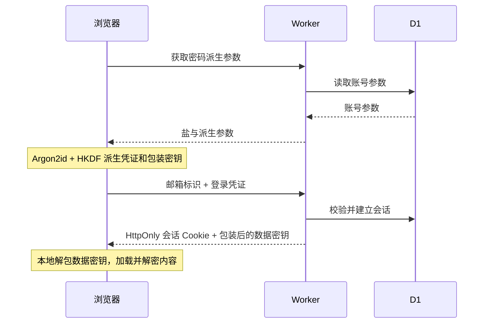

# 架构与数据流

[返回项目首页](../README.md) · [安全设计](SECURITY.md) · [开发指南](DEVELOPMENT.md)

## 组件分工

| 层         | 技术                     | 职责                                                 |
| ---------- | ------------------------ | ---------------------------------------------------- |
| 浏览器     | React、TypeScript、Vite  | 编辑器、搜索、界面偏好、个人信息、加解密、附件与备份 |
| API        | Hono、Cloudflare Workers | 单账号初始化、会话与来源校验、版本控制、上传与清理   |
| 内容数据库 | D1                       | 内容密文、个人信息密文、账号、会话与附件索引         |
| 对象存储   | 私有 R2                  | 加密后的附件分块，包括头像                           |
| 静态资源   | Workers Static Assets    | 前端构建产物、Logo、favicon 与品牌资源               |

## 数据模型

| 表            | 内容                                           |
| ------------- | ---------------------------------------------- |
| `vault`       | 唯一账号、密码派生参数、数据密钥包装与恢复包装 |
| `sessions`    | 会话令牌校验、设备信息、到期时间与账号版本     |
| `notes`       | 条目密文、版本、时间、置顶和回收站状态         |
| `profiles`    | 昵称等个人信息密文、当前头像引用与版本         |
| `attachments` | 加密元数据、所属对象、字节数与上传状态         |
| `chunks`      | 分块索引与字节统计                             |
| `attempts`    | 登录与恢复等敏感接口的尝试次数                 |
| `deletions`   | 可重试删除的状态标记                           |
| `maintenance` | 分批 R2 清理的游标                             |

表结构来自 [`migrations/0001_initial.sql`](../migrations/0001_initial.sql)，在首次 API 请求时幂等初始化。新增表不会清空现有数据。

## 登录与解锁

登录字段在协议和数据库中仍保留 `username` 名称，以兼容已有账号。界面使用“邮箱”，修改昵称不改变登录标识。

## 条目保存

编辑器在短暂防抖后，将完整内容快照加密，携带当前版本发送到 API。D1 以版本条件更新记录，成功后客户端更新保存时间和列表。版本冲突时拒绝覆盖，允许保留编辑并保存为副本。

搜索在浏览器解密后的标题、正文、凭据字段与标签中进行。服务端不提供明文全文搜索。

## 附件与头像

1. 浏览器用独立上下文加密文件元数据。
2. 创建附件索引，将原始文件按 4 MiB 分块加密上传。
3. R2 分块使用 `files/<附件 ID>/<分块序号>` 对象路径。服务端核对分块后标记上传完成。
4. 预览和下载经过鉴权，浏览器按上下文验证、解密并校验总长度。

头像复用同一流程，通过保留的所属对象 ID 与普通备忘录附件区分。个人信息只在头像上传完成后更新引用，并带版本校验。当前头像不能直接删除；更新后旧图可删除，废弃上传会由定时任务清理。

昵称保存在个人信息密文中。头像不会进入备忘录列表，但其文件和个人信息密文计入用量。

## 备份与导入

空间备份是包含条目密文、附件分块、个人信息记录和数据密钥包装的 JSON 文件，扩展名为 `.cmbackup`。

导入时使用导出时的密码解包旧数据密钥，先验证内容和文件，再用当前空间数据密钥重新加密为新条目。已有内容保留。只有当前空间尚未设置个人信息时，才恢复备份昵称与头像。

## 运维与兼容

- 非本机 HTTP 请求跳转到 HTTPS；客户端在处理密码前检查 Web Crypto 是否可用。
- Cookie、账号版本、会话到期与请求来源共同保护 API。
- 每日 Cron 处理到期回收站、会话、上传和孤立分块。
- 静态资源与 API 位于同一部署，测试通过 Miniflare 使用本地 D1 / R2。
- 主题和语言偏好只保存在浏览器本地；个人信息和内容保存到云端。

更多加密参数、客户端信任假设和存储限制见[安全设计](SECURITY.md)。
